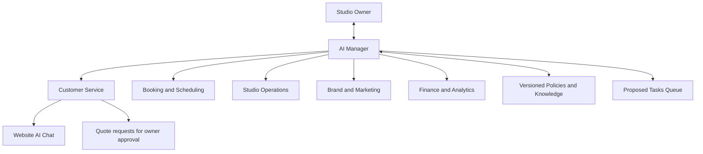

# Memory Lane AI Manager Architecture (staging)

## Ownership model

## What is implemented in the staging branch

- AI Manager Console in Memory Lane Admin. Staging Admin can chat to a Manager assistant in Vietnamese.
- Manager proposes tasks for the five departments, stored with `status=proposed`; these tasks are **not executed**.
- `ai_agent_registry` lists Manager and Customer Service as preview components; Booking, Operations, Marketing and Finance are planned.
- `ai_policy_versions` keeps one active version per knowledge area, with archived versions preserved.
- Studio owner can explicitly publish a new policy through the Manager Console after a confirmation prompt.
- Customer Service's model prompt loads owner-published brand voice, service, customer service and booking policies for new responses.
- Hard-coded restrictions still prevent personalised prices in live chat and unapproved booking confirmations.
- Manager chat requires verified staging Admin login plus `AI_MANAGER_ENABLED=true` in Cloudflare Preview.
- Manager backend runs structured JSON output from OpenAI Responses API and stores only task proposals.
- Only staging cloudflare branch Preview hosts can call the Manager API, never the production domain.
- Backend per-admin limit: 20 Manager messages/hour. Rate limiter RPC is service-role only.

## Supabase staging

Project: `memory-lane-ai-staging` (`livorstsjtixdgksuzou`).
Migration: `create_ai_manager_staging_core`.
Tables: `ai_agent_registry`, `ai_policy_versions`, `ai_manager_messages`, `ai_manager_tasks`.
Function: `ai_publish_policy` as `SECURITY INVOKER`, granted only to service_role.
RLS is enabled. Anonymous and general authenticated users do not receive direct table access.

## What is NOT implemented

- No automatic execution of Manager-created tasks.
- No outbound email or Messenger/Instagram automation.
- No calendar integration, confirmed bookings, payments, refunds or marketing publishing.
- No cross-device customer conversation recovery; this still requires verified email.
- No full retention/deletion process or production deployment.

## Next prerequisites for an owner-operated staging test

1. Completed: staging Auth user created and email confirmed; user granted access in staging `admin_users` (verified 28 November 2026).
2. Set `AI_MANAGER_ENABLED=true` in **Cloudflare Preview only**, after confirming staging Supabase public and secret keys are configured.
3. Confirm the OpenAI key belongs to Memory Lane's API project and has a low usage budget.
4. Open the branch Preview `admin.html`, sign in with the staging user, open AI Manager, ask it to propose a Customer Service task.
5. Review the proposed task and publish a harmless staging policy to test versioning.
6. Separately configure Turnstile site/secret keys before enabling public website chat.

## Release gates

- Check staging SQL/permissions and smoke tests.
- Test Admin auth failure and legitimate Admin login with mock data.
- Add verified client identity, outbox approvals, retention, abuse monitoring and budget enforcement.
- Review and explicitly approve the PR before any merge to production.

Do not merge this branch while any release gate is open.